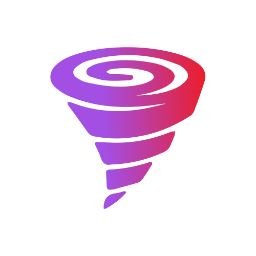
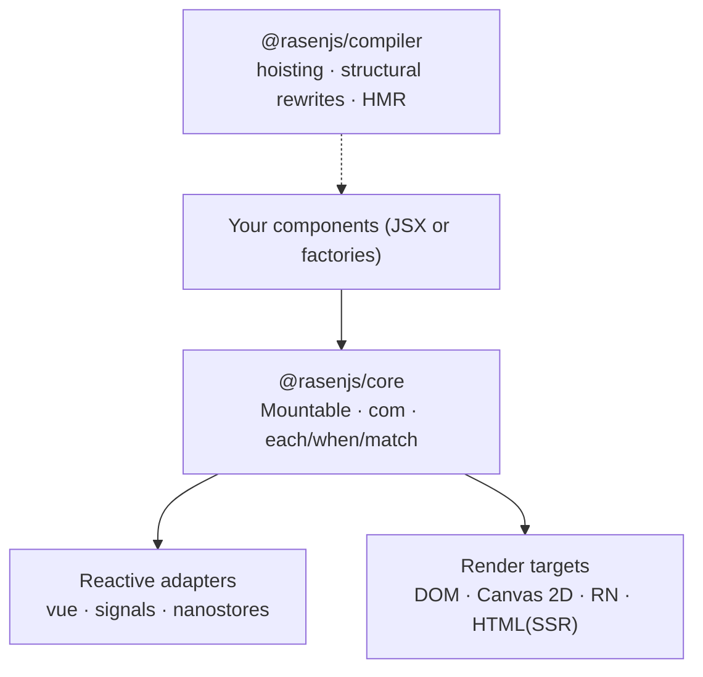
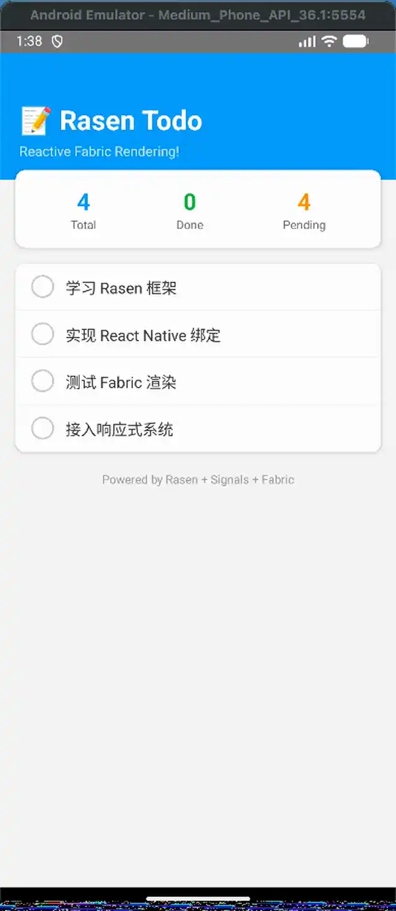
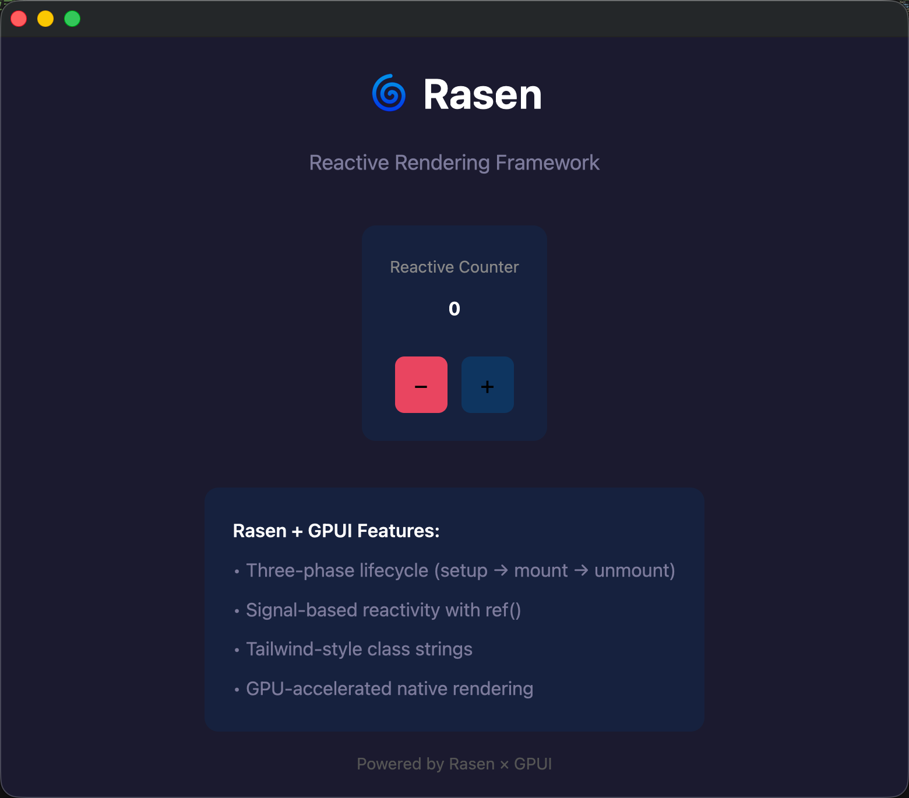
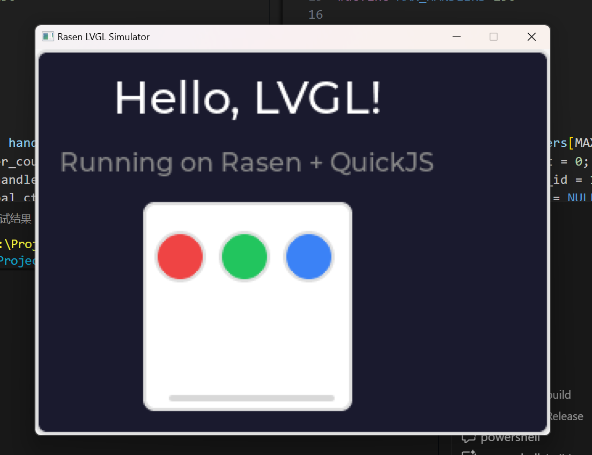

# 🌀 Rasen

<p align="center">
  
</p>

<p align="center">
  <strong>らせん (Spiral)</strong><br>
  <em>One Reactive Core, Multiple Render Targets</em><br><br>
  A reactive rendering framework agnostic to both reactive systems and rendering targets.<br>
  Write once, render to <b>DOM</b>, <b>Canvas 2D</b>, <b>React Native</b>, <b>HTML (SSR)</b>, <b>WebGL</b>, and more.
</p>

<p align="center">
  <a href="./docs/DESIGN.md"><strong>📖 Design Philosophy</strong></a> •
  <a href="#quick-start">Quick Start</a> •
  <a href="#packages">Packages</a> •
  <a href="#target-previews">Targets</a> •
  <a href="#documentation">Documentation</a> •
  <a href="#roadmap">Roadmap</a>
</p>

> ⚠️ **Alpha.** The framework is being prepared for its first public release:
> most rendering and routing packages are on npm, the compiler and several
> targets are still repo-only, and APIs may change between alpha releases.

## What is Rasen?

One paradigm, two decouplings:

- **Reactive decoupling** — bring your own reactivity (Vue refs, TC39 Signals,
  nanostores, alien-signals) or use the zero-dependency runtime built into core.
  Rasen calls into it through a six-member `ReactiveRuntime` interface.
- **Render-target decoupling** — the same component renders to DOM, Canvas 2D,
  React Native, an HTML string, or any host you write. A host only needs to
  implement `Mountable` + `HostHooks`.

Everything else follows from one type:

```typescript
type Mountable<Node = unknown> = (
  node: Node,
  hooks: HostHooks<Node> | undefined
) => (() => void) | undefined
```

A component receives a host, mounts itself into it, and returns a cleanup
function. No virtual DOM, no component instances, no re-render pass.



## Quick Start

```bash
npx degit rasenjs/rasen/templates/rasen-ts my-rasen-app
cd my-rasen-app
npm install
npm run dev          # http://localhost:3000
```

The template is an SSR + hydration app with isomorphic routing, signals and the
compiler already configured — see
[Getting Started](./www/guide/getting-started.md) for the
step-by-step path, or add Rasen to an existing Vite project:

```bash
npm install @rasenjs/web @rasenjs/router @rasenjs/reactive-signals signal-polyfill
npm install -D @rasenjs/compiler
```


## Example

```tsx
import { Signal } from 'signal-polyfill'
import { com } from '@rasenjs/core'
import { useReactiveRuntime } from '@rasenjs/reactive-signals'
import { mount } from '@rasenjs/dom'

useReactiveRuntime()

const Counter = com(() => {
  const count = new Signal.State(0)
  const double = new Signal.Computed(() => count.get() * 2)

  return (
    <div class="counter">
      {/* a bare ref interpolates directly: the compiler emits a renderText()
          binding that unwraps it through the active runtime */}
      <p>Count: {count} (doubled: {double})</p>
      <button onClick={() => count.set(count.get() + 1)}>+</button>
    </div>
  )
})

mount(<Counter />, document.getElementById('app')!)
```

No JSX? Every host also ships function factories with the same semantics —
`div({ class: 'counter' }, p({}, 'Count: ', count), button({ onClick: inc }, '+'))`.

## Packages

Status legend: ✅ published on npm (alpha) · 🚧 in this repo, not yet published ·
🏗️ work in progress.

### Framework

| Package | Description | Status |
| ------- | ----------- | ------ |
| [`@rasenjs/core`](./packages/core) | Paradigm, structural components, reactive-runtime boundary, JSX runtime | ✅ alpha |
| [`@rasenjs/compiler`](./packages/compiler) | JSX static hoisting, structural rewrites, HMR — Vite/webpack/Rspack/esbuild + Babel | 🚧 |
| [`@rasenjs/dom`](./packages/dom) | DOM renderer: elements, bindings, hydration, compiled templates | ✅ alpha |
| [`@rasenjs/html`](./packages/html) | HTML string renderer for SSR/SSG | ✅ alpha |
| [`@rasenjs/web`](./packages/web) | Isomorphic bundle: DOM in the browser, HTML on the server | ✅ alpha |

### Routing

| Package | Description | Status |
| ------- | ----------- | ------ |
| [`@rasenjs/router`](./packages/router) | Headless router: typed routes, params, guards, history adapters | ✅ alpha |
| [`@rasenjs/router-dom`](./packages/router-dom) | Link + `RouterView` for the DOM, scroll restoration, layout | ✅ alpha |
| [`@rasenjs/router-html`](./packages/router-html) | The same components for the SSR string host | ✅ alpha |

### Reactivity adapters

| Package | Description | Status |
| ------- | ----------- | ------ |
| [`@rasenjs/reactive-vue`](./packages/reactive-vue) | `@vue/reactivity` adapter | ✅ alpha |
| [`@rasenjs/reactive-signals`](./packages/reactive-signals) | TC39 Signals (`signal-polyfill`) adapter | ✅ alpha |
| [`@rasenjs/reactive-nanostores`](./packages/reactive-nanostores) | nanostores adapter | ✅ alpha |
| [`@rasenjs/reactive-alien-signals`](./packages/reactive-alien-signals) | alien-signals adapter | 🚧 |

### Render targets

| Package | Description | Status |
| ------- | ----------- | ------ |
| [`@rasenjs/canvas-2d`](./packages/canvas-2d) | Canvas 2D shapes, text, paths, sprites, groups | ✅ alpha |
| [`@rasenjs/rn-dom`](./packages/rn-dom) | DOM-like document abstraction over React Native Fabric | ✅ alpha |
| [`@rasenjs/react-native`](./packages/react-native) | React Native components on `rn-dom` (no React) | 🚧 |
| [`@rasenjs/rn-html`](./packages/rn-html) | HTML tag set for the RN targets | 🚧 |
| [`@rasenjs/gfx`](./packages/gfx) | WebGL/WebGPU renderer sharing canvas-2d's shape API | 🏗️ |
| [`@rasenjs/gpui`](./packages/gpui) | Native desktop through Zed's GPUI | 🏗️ |
| [`@rasenjs/lvgl`](./packages/lvgl) | Embedded displays (LVGL + QuickJS) | 🏗️ |
| [`@rasenjs/lynx`](./packages/lynx) | Lynx main-thread rendering | 🏗️ |
| [`@rasenjs/winui3`](./packages/winui3) | WinUI 3 (research stage) | 🏗️ |

### Utilities

| Package | Description | Status |
| ------- | ----------- | ------ |
| [`@rasenjs/tw`](./packages/tw) | Tailwind-style class strings → style records | 🚧 |
| [`@rasenjs/rota`](./packages/rota) | Headless UI component library | 🚧 |
| [`@rasenjs/animation`](./packages/animation) | Tween, spring and frame animations as refs | ✅ alpha |
| [`@rasenjs/math`](./packages/math) | `Vec2/3/4f`, `Mat3x3f`, `Mat4x4f`, `Quatf` | 🚧 |
| [`@rasenjs/assets`](./packages/assets) | Spine + glTF/GLB parsing, host-injected image loading | 🚧 |

Installing a 🚧 package means building it from this repository
(`yarn install && yarn build`); the workspaces link everything together.

## Target previews

### 🖥️ Web (DOM + SSR)

```tsx
import { useReactiveRuntime } from '@rasenjs/reactive-signals'
import { mount } from '@rasenjs/dom'

useReactiveRuntime()
mount(<App />, document.getElementById('app')!)
```

### 🎨 Canvas 2D

```tsx
import { canvas, mount } from '@rasenjs/dom'
import { rect, text } from '@rasenjs/canvas-2d'
import { tween } from '@rasenjs/animation'

const x = tween(50)

mount(
  canvas({
    width: 400,
    height: 200,
    children: [
      rect({ x, y: 50, width: 100, height: 80, fill: '#4CAF50' }),
      text({ text: 'Rasen', x: 12, y: 24 })
    ]
  }),
  document.getElementById('app')!
)
```

### 📱 React Native (no React)

<p align="center">
  
</p>

```tsx
import { View, Text, TouchableOpacity, registerApp } from '@rasenjs/react-native'
import { useReactiveRuntime } from '@rasenjs/reactive-vue'
import { ref } from '@vue/reactivity'

useReactiveRuntime()
const count = ref(0)

registerApp('MyApp', () => (
  <View style={{ flex: 1, justifyContent: 'center', alignItems: 'center' }}>
    <Text style={{ fontSize: 48 }}>{count}</Text>
    <TouchableOpacity onPress={() => count.value++}>
      <Text>+</Text>
    </TouchableOpacity>
  </View>
))
```

### 🖥️ Native desktop (GPUI)

<p align="center">
  
</p>

```typescript
import { div, text, button, run } from '@rasenjs/gpui'
import { ref } from '@rasenjs/reactive-signals'
import { com } from '@rasenjs/core'

const App = com(() => {
  const count = ref(0)

  return div({
    class: 'flex flex-col gap-4 size-full justify-center items-center bg-[#1a1a2e]',
    children: [
      text({ class: 'text-4xl text-white font-bold', children: '🌀 Rasen' }),
      // a ref in a child position is reactive
      text({ class: 'text-5xl text-white', children: count }),
      button({
        class: 'px-4 py-2 bg-[#e94560] rounded-lg text-white',
        onClick: () => count.value++,
        children: [text({ children: '+' })]
      })
    ]
  })
})

run(App)   // GPU-accelerated native window
```

Tailwind-style class strings are supported by the `gpui` and `lvgl` targets'
own class parsing; [`@rasenjs/tw`](./packages/tw) provides the shared
interpreter (`tw('flex gap-2')` → a camelCase style record) when you want to
resolve them yourself or pre-generate them with the AOT CLI.

### 🔌 Embedded (LVGL + QuickJS)

<p align="center">
  
</p>

`packages/lvgl` ships a desktop simulator for the embedded target (LVGL +
QuickJS-ng + SDL2); see its [README](./packages/lvgl/README.md) for the native
build steps.

### 📄 HTML (SSR)

```typescript
import { renderToString, div, p, ul, li } from '@rasenjs/html'

const html = renderToString(
  div({ class: 'container' }, p({ class: 'title' }, 'Hello from SSR!'), ul({}, li('One'), li('Two')))
)
// <div class="container"><p class="title">Hello from SSR!</p><ul><li>One</li><li>Two</li></ul></div>
```

## Examples

```bash
yarn examples:web:dev          # DOM, canvas, JSX, transitions, HMR
yarn examples:nikke-viewer:dev # game-style app with the GL target
yarn examples:mario:dev        # sprite/animation driven by the frame scheduler
yarn examples:ssr:dev          # server rendering + hydration
```

| Example | What it shows |
| ------- | ------------- |
| [`examples/web`](./examples/web) | DOM, Canvas 2D, JSX, transitions, HMR |
| [`examples/ssr`](./examples/ssr) | SSR + hydration |
| [`examples/react-native`](./examples/react-native) | RN app without React |
| [`examples/canvas-2d`](./examples/canvas-2d) | shape gallery and animation |
| [`examples/gfx`](./examples/gfx) | WebGL rendering of the canvas-2d API |
| [`examples/racing`](./examples/racing), [`examples/fps`](./examples/fps), [`examples/mario`](./examples/mario), [`examples/kenney-fps`](./examples/kenney-fps), [`examples/kenney-racing`](./examples/kenney-racing) | games |
| [`examples/nikke-viewer`](./examples/nikke-viewer), [`examples/perry-nikke-viewer`](./examples/perry-nikke-viewer) | Spine/sprite viewers, incl. the Perry AOT build |
| [`examples/craft`](./examples/craft) | voxel-style world |
| [`examples/router-demo`](./examples/router-demo) | routing on both targets |
| [`examples/lvgl`](./examples/lvgl), [`examples/gpui`](./examples/gpui) | embedded and native desktop |

## Documentation

- **[Website](./www)** — guide, API reference and examples; deployed from `www/` (see `vercel.json`)
- **[DESIGN.md](./docs/DESIGN.md)** — why Rasen is built this way
- **[COMPILE-DESIGN.md](./docs/COMPILE-DESIGN.md)** — the static-hoisting compiler
- **[HMR-DESIGN.md](./docs/HMR-DESIGN.md)** — dev-time remounting and module boundaries
- **[GPU-BACKEND-DESIGN.md](./docs/GPU-BACKEND-DESIGN.md)** — the WebGL/WebGPU backend
- **[PERRY-AOT.md](./docs/PERRY-AOT.md)** — ahead-of-time compilation with Perry, and [PERRY-PITFALLS.md](./docs/PERRY-PITFALLS.md)
- **[SPINE-PERF.md](./docs/SPINE-PERF.md)** — the Spine runtime's performance work
- Package READMEs — [core](./packages/core), [compiler](./packages/compiler), [dom](./packages/dom), [html](./packages/html), [web](./packages/web), [router](./packages/router), [canvas-2d](./packages/canvas-2d), [rota](./packages/rota), [tw](./packages/tw)

## Roadmap

| Area | Status | Notes |
| ---- | ------ | ----- |
| DOM / HTML / SSR | ✅ alpha | published, used by the template |
| Routing | ✅ alpha | typed routes, guards, isomorphic views |
| Compiler | 🚧 | publish with the first release; opt-in structural rewrites |
| Canvas 2D | ✅ alpha | shapes, text, paths, sprites, pointer delegation |
| WebGL / WebGPU (`gfx`) | 🏗️ | shares the canvas-2d shape API |
| React Native (`rn-dom`) | ✅ alpha | Fabric without React; components still landing |
| Native desktop (GPUI) | 🏗️ | Tailwind-style classes, signals |
| Embedded (LVGL) | 🏗️ | QuickJS + LVGL, desktop simulator included |
| Lynx, WinUI 3 | 🏗️ | research / early |
| Single-file components | 📋 planned | |

## Development

```bash
yarn install        # install workspaces
yarn build          # build every package (tsup)
yarn test           # vitest
yarn typecheck      # tsc --noEmit per package
yarn lint           # eslint

yarn www:dev        # documentation site (VitePress)
yarn www:build
```

`docs/` holds the design notes; `www/` is the website and guide; each package
keeps its own README (the site includes them, so they stay in sync).

## License

[MIT](./LICENSE)

<p align="center">
  <em>Rasen — らせん — one reactive core, many render targets.</em>
</p>
